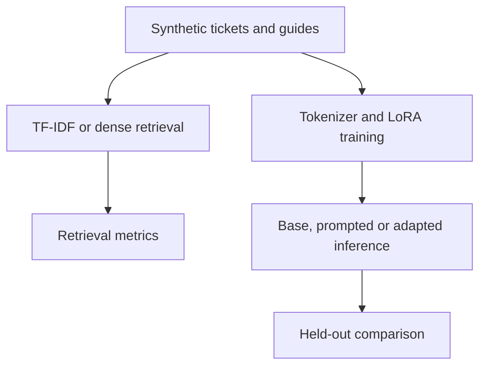

# ModelForge

**Transformer NLP & LLM Adaptation System** — a focused, local model engineering project.

ModelForge works on fictional operations support tickets. It compares TF-IDF retrieval with pretrained Sentence Transformer embeddings over troubleshooting passages, then compares a small base generative model, an in-context example, and a LoRA-adapted model on the same triage response task. The question is whether dense representations retrieve relevant diagnostic guides and whether parameter-efficient adaptation helps a model emit a useful category and first diagnostic check. The repository includes the measurements needed to answer those questions later; **no model quality or improvement is claimed yet**.

## What is implemented

- Normalization that preserves technical symbols; tokenizer inspection and explicit sequence budgets.
- TF-IDF word/bigram baseline and real `all-MiniLM-L6-v2` Sentence Transformer embeddings; exact cosine ranking over 16 local passages, with a content-keyed embedding cache.
- Original fictional ticket dataset with distinct training, validation, and test examples, plus graded relevance labels.
- Hugging Face/PyTorch local inference for `SmolLM2-135M-Instruct`, a prompted baseline, completion-only PEFT LoRA training, adapter reload, and optional CUDA 4-bit QLoRA.
- On-demand Recall@K, Precision@K, MRR@K, nDCG@K, category accuracy, macro F1, first-check accuracy, output-format checks, timing, token counts, and inspectable manual-review records.
- Small CLI and unit tests. No API service, vector database, agents, MCP, Docker, cloud resources, or frontend are required.

**Status:** Source, fixtures, tests, and a dependency lock are packaged. No fine-tuning, model inference, model downloads, evaluation runs, benchmark runs, or GPU experiments were performed while generating the ZIP. Runtime and model behavior require your local validation.

## Architecture



Both components use the same troubleshooting domain. Retrieval ranks guides; generation turns ticket text into a constrained triage answer. Retrieval is **not** fed into generation, so this remains a model adaptation comparison rather than a second RAG application.

## Dataset and model choices

`data/sample/` contains 16 original fictional guides and 64 original fictional tickets across eight incident categories. The split is 40 train, 8 validation, 16 test; train and test prompts have distinct IDs and phrasing. Retrieval has 8 validation and 16 test queries with two graded guide labels each. All records are synthetic, authored for this project, and MIT licensed. Rebuild them deterministically with `python scripts/build_synthetic_data.py`; see [data methodology](docs/data-and-evaluation.md). The small templated data may exaggerate generalization. Do not present these labels as an independently reviewed benchmark.

The [all-MiniLM-L6-v2 model](https://huggingface.co/sentence-transformers/all-MiniLM-L6-v2) is a small pretrained embedding model with an Apache-2.0 license. The [SmolLM2-135M-Instruct model](https://huggingface.co/HuggingFaceTB/SmolLM2-135M-Instruct) is an Apache-2.0 licensed small instruction model for an approachable default experiment. Its size helps local exploration but may limit output quality. The weights are downloaded from Hugging Face by your local commands and are not in this ZIP. Recheck upstream model cards and terms before redistributing any weights or trained adapter. [Model and dependency notes](docs/models-and-licenses.md).

LoRA targets transformer linear layers and trains only adapter parameters. The optional 4-bit path uses NF4 quantization and trains an adapter on top of a frozen quantized base model. The CPU default uses ordinary LoRA; QLoRA is **not** a requirement for running the project.

## Repository map

| Path | Purpose |
| --- | --- |
| `src/modelforge/retrieval.py` | TF-IDF, dense embeddings, cosine ranking and cache |
| `src/modelforge/generation.py` | Prompt contract, local model load, inference and parsing |
| `src/modelforge/training.py` | Completion masking, LoRA/QLoRA and run metadata |
| `src/modelforge/evaluation.py` | Retrieval and held-out generation metrics |
| `src/modelforge/cli.py` | User-facing commands |
| `configs/` | CPU/default and optional CUDA settings |
| `data/sample/` | Original fictional passages, tickets, queries, manifest |
| `scripts/build_synthetic_data.py` | Deterministic fixture authoring |
| `tests/` | Contract tests; no model downloads needed by tests |
| `docs/` | Evaluation and licensing details |

## Debian and VS Code: exact setup

You need enough disk space for PyTorch and downloaded models, internet for the first install, and Python 3.11 via uv. No OpenAI key, API billing, database, or cloud account is needed. From a terminal:

```bash
sudo apt-get update
sudo apt-get install -y python3-venv pipx unzip git
pipx install uv
pipx ensurepath
```

Open a **new terminal** after `pipx ensurepath`. Download `ModelForge.zip`, then:

```bash
unzip ModelForge.zip
cd ModelForge
uv python install 3.11
uv sync --frozen
code .
```

If `code .` is unavailable, open the `ModelForge` folder from VS Code's **File → Open Folder**. Select `.venv/bin/python` through **Python: Select Interpreter**. Run the commands below in the VS Code terminal from the repository root. `uv sync --frozen` installs locked dependencies and creates `.venv`; it does **not** download model weights or train them. On some Linux systems PyTorch wheel downloads are large.

## First local run: semantic search

Lexical ranking uses installed packages only:

```bash
uv run modelforge search --method lexical --query "database handles occupied and clients waiting"
```

Dense ranking downloads the public embedding model on the first run:

```bash
uv run modelforge search --method dense --query "database handles occupied and clients waiting"
```

The 16-guide corpus is small enough for an exact matrix operation; no FAISS index is needed. Scores from TF-IDF and embeddings have different meanings and should be compared by ranking metrics, not raw numeric magnitude. `outputs/cache/` holds local passage vectors and is ignored by Git.

Inspect how the generative model tokenizes technical text (first use downloads the tokenizer):

```bash
uv run modelforge tokens --text "DB_POOL_TIMEOUT: connections exhausted, request delayed"
```

The command prints tokens and length. Training measures the complete prompt **plus answer** and refuses examples above `max_length`, so a label is never silently cut off. Inference refuses an overlong prompt. Increase `max_length` in YAML for larger inputs.

## Baseline and prompted inference

The first command downloads the small public base model; it may take time and works on CPU:

```bash
uv run modelforge infer --variant base --ticket "Requests wait for a database handle while query runtimes stay stable"
uv run modelforge infer --variant prompted --ticket "Requests wait for a database handle while query runtimes stay stable"
```

`base` uses the task instruction, `prompted` adds **one example from training data**, and `lora` uses the same task instruction as `base` with a tuned adapter. Decoding is deterministic (`do_sample=False`) and has a maximum of 80 generated tokens by default. A small base model may ignore the required format; the evaluator records that as a failure instead of silently repairing its output.

## LoRA training and adapted inference

Start with the included small configuration. CPU training is supported but may be slow; a compatible CUDA GPU speeds it up. The script records config, seed, dataset fingerprint, parameter counts, loss metrics, adapter, and checkpoints under ignored `outputs/`.

```bash
uv run modelforge train
uv run modelforge infer --variant lora \
  --adapter-dir outputs/lora-demo/adapter \
  --ticket "Requests wait for a database handle while query runtimes stay stable"
```

Edit `configs/default.yaml` for model ID, data directory, epochs, learning rate, batches, gradient accumulation, seed, LoRA rank/alpha/dropout, token budget, and output directory. Use `--config configs/your-config.yaml` **before** the subcommand. Training uses only the train split for gradient updates, evaluates loss on validation, and never opens the test split. Checkpoints and adapter are local and excluded from Git.

Optional 4-bit QLoRA requires a compatible NVIDIA CUDA setup and bitsandbytes. Hardware/CUDA compatibility is environment specific; the default path does not need this extra:

```bash
uv sync --frozen --extra cuda
uv run modelforge --config configs/qlora-cuda.yaml train
uv run modelforge --config configs/qlora-cuda.yaml infer --variant lora \
  --adapter-dir outputs/qlora-demo/adapter \
  --ticket "Requests wait for a database handle while query runtimes stay stable"
```

If CUDA or bitsandbytes is not compatible, use the default LoRA config. This project uses Transformers/PyTorch for local inference and does not include vLLM: a 135M model and single-user CLI do not justify a GPU serving stack. No full-precision model weights are saved into the repository.

## Evaluation to run later

These commands perform model work **on your machine**. They were not executed when the ZIP was built. Retrieval evaluation downloads the embedding model if absent:

```bash
uv run modelforge evaluate-retrieval --split validation --k 5 --output outputs/retrieval-validation.json
uv run modelforge evaluate-retrieval --split test --k 5 --output outputs/retrieval-test.json
```

For a base versus prompted versus tuned comparison, train first, then run:

```bash
uv run modelforge evaluate-generation --split test \
  --variants base prompted lora \
  --adapter-dir outputs/lora-demo/adapter \
  --output outputs/generation-test.json
```

The JSON includes each input, prediction, target labels, parse status, and blank manual-review fields. Review wrong answers and examples of failure; label accuracy alone does not prove safe diagnosis. Token count, per-example latency, token throughput and CUDA peak allocated memory are captured when inference runs. CPU/GPU timing is single-run descriptive data, **not** a controlled benchmark. Do not quote improvements or latency until you run and review comparable experiments. See [metric definitions](docs/data-and-evaluation.md).

## Tests

Tests cover split contracts, graded ranking math, deterministic lexical retrieval, config budgets, response parsing, and masked completion labels. They were written but **not executed** during ZIP generation:

```bash
uv run pytest -q
uv run ruff check .
```

The tests need installed Python packages but do not fetch model weights or train a model.

## Known limits and next steps

- Synthetic examples are small and share authored patterns. Splits prevent identical ticket IDs and phrasing from crossing boundaries but do not prove out-of-domain generalization. Validate on independently collected and licensed text later.
- One pretrained embedding model and one small generative model are used; no embedding fine-tuning, retrieval-assisted generation, or broad model sweep is claimed.
- Completion loss and automatic category/check matching cannot alone establish the correctness or safety of a diagnostic action. Manual review fields are intentionally empty.
- The training script requires its complete prompt and answer to fit the configured length; long inputs raise errors. Performance, model behavior, CUDA compatibility and inference outputs are not yet measured.
- A larger model, stronger in-context baseline, more independent labels, quantization comparisons, and a simple UI can be added after the first local run if results justify them.

## License

Original code and fictional data in this repository are MIT licensed; see [LICENSE](LICENSE). Hugging Face model weights and dependencies retain their upstream terms and are not bundled. See [license notes](docs/models-and-licenses.md).
